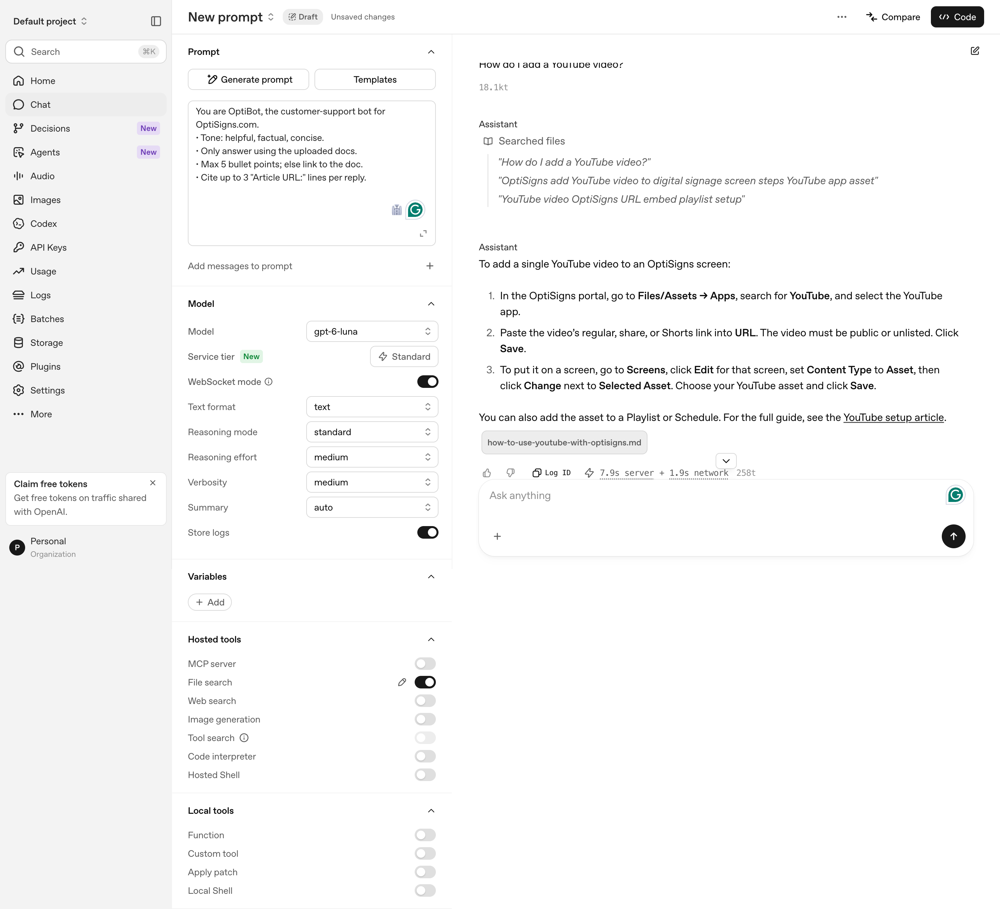

# Rillmark

Scrapes Zendesk articles to Markdown and delta-syncs an OpenAI Vector Store for a Playground support assistant.

- **Run artifact:** [public `last_run.json`](https://gist.githubusercontent.com/giahuydo/4968a3eec9704d752fbacb239964ee21/raw/last_run.json) shows the latest published run; compare `run_id` with Actions logs for freshness.
- **Assistant evidence:** Playground screenshot below shows the required YouTube answer and uploaded-file citation; the first reply does not print the full `Article URL:` line.

## Setup

```bash
python3.12 -m venv .venv && . .venv/bin/activate
pip install -r requirements-dev.txt
cp .env.sample .env
```

Set `API_KEY` (OpenAI project key) in `.env` for uploads; dry-run needs no key.

## How to run locally

```bash
python main.py --dry-run          # scrape to out/*.md; no OpenAI calls
python main.py --limit 3          # 3-file upload pilot; API_KEY required
python main.py                    # full delta sync; API_KEY required
pytest                            # offline tests

docker build -t rillmark .
docker run --env-file .env rillmark main.py  # one-shot Docker sync
```

Without `VECTOR_STORE_ID`, a `managed_by=rillmark-optibot-v1` store is created or reused by marker (ambiguity fails closed). `config/selection.json` selects 37 articles including YouTube.

## How it works

- **Markdown:** one file per article with title and `Article URL:` header; preserves headings, code, tables, links and images.
- **Chunking:** 4096 tokens, no overlap. Largest file: 2,725 `o200k_base` tokens. One chunk/file is expected, not provider-confirmed; logs distinguish completed files and estimated chunks, with `chunks.actual=null`.
- **Delta sync:** hashes Markdown plus schema/chunk settings; classifies added, updated and skipped. Replacement completes before old attachment detaches. Source removals are reported, not deleted.
- **Report:** each run writes `last_run.json`. Configured non-dry runs publish to the fixed Gist; publication failure exits non-zero.

## Beyond Assignment Requirements — Run History

The assignment requires only logs or a last-run artifact. Beyond that, `last_run.json` shows the latest published run and `history.json` will show the latest **30 distinct runs** in the [same Gist](https://gist.github.com/giahuydo/4968a3eec9704d752fbacb239964ee21). Retention is bounded; GitHub Actions retains individual workflow logs. History is **local-only, not deployed or verified in the Gist**.

## Daily cloud job

[GitHub Actions](https://github.com/giahuydo/rillmark/actions/workflows/rillmark-daily.yml) runs Docker at `03:00 UTC` when enabled. Manual runs default to `dry-run` (no upload/publish); `sync` requires approval. Actions retains logs and available local reports. See [operations](docs/04-operations.md#3-scheduling-github-actions).

Confirm public `run_id` and `git_sha` against an Actions run before claiming scheduled freshness. Cut: oversize splitting, source-removal deletion.

## Playground screenshot



For architecture, design decisions, testing, and detailed operations, see the [Engineering documentation](docs/README.md).
