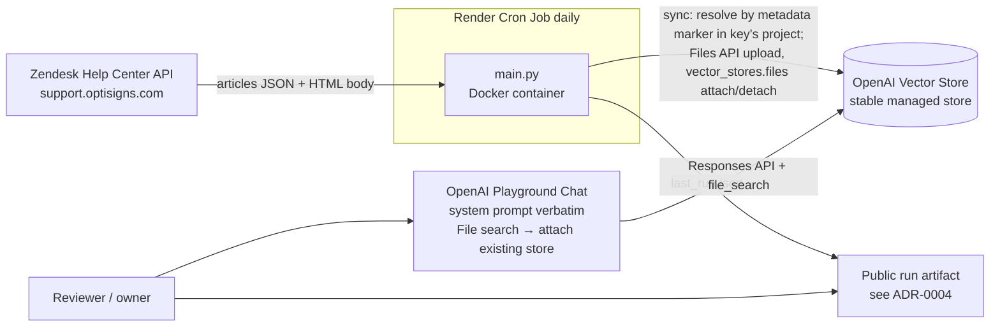

# 01 — Architecture

Back to [docs index](README.md). Related: [02-data-contracts](02-data-contracts.md), [03-sync-lifecycle](03-sync-lifecycle.md), [ADR-0001](adr/0001-ai-provider.md), [ADR-0002](adr/0002-chunking-and-citation.md).

## 1. Requirements served

R1–R13 from [00-requirements](00-requirements.md#2-functional-requirements-from-the-assignment). Design goal: **one short-lived Python process** that runs to completion and exits. No server and no database.

## 2. System context



## 3. Pipeline (one run)

```
main.py
 1. parse mode + load_config()         # --dry-run (no OpenAI calls), --limit N (pilot), default sync
 2. fetch_articles()                  # Zendesk API, paginated, en-us, non-draft
 3. select_articles()                 # config/selection.json or env overrides → ≥ 30, YouTube included
 4. to_markdown(article)              # HTML → normalized Markdown + header (02 §2)
 5. check serialized file token budget; write out/<slug>.md (no silent truncation)
 6. sha256("v{schema_version}\nchunk={max}/{overlap}\n" + normalized_markdown)
 7. resolve_store()                    # sync: VECTOR_STORE_ID or marker discovery/create in key's project
 8. load_remote_state(store)          # list vector store files + attributes (03 §2)
 9. classify → added / updated / skipped / deletion_candidates (log absent IDs only)
10. apply delta                       # upload → attach w/ attributes → poll → detach own old version
11. report observed files + estimated chunks (actual null); write last_run.json; publish artifact
12. exit 0 only if sync and required publish succeeded; otherwise 1
```

`--dry-run` means **no OpenAI calls** (it still fetches Zendesk): validate the full selection, convert and write local Markdown without requiring `API_KEY` or `VECTOR_STORE_ID`; it cannot claim uploads or remote counts. Default sync requires `API_KEY` and resolves its store in that key's project: `VECTOR_STORE_ID` set → retrieve it, require vector store `metadata.managed_by = "rillmark-optibot-v1"`, else fail closed. Unset → list stores in the key's project (all pages), filter by that marker: 0 → create (named `rillmark-optibot`, with marker, no `expires_after`); 1 → reuse; >1 → fail closed. Display name is never used for matching. `--limit N` is a pilot upload cap applied **after** full ≥30 selection validation; its deterministic subset always includes the YouTube article and the longest file. Pilot never detaches or deletes, and its counts are labeled `pilot`. No `--init-store` mode exists. Phase 1 can use dry-run while G0 (credits) is blocked.

## 4. Module layout (planned, kept small)

| Module | Responsibility | Has network? |
|---|---|---|
| `main.py` | CLI flags (`--dry-run`, `--limit`), orchestration, exit code | — |
| `rillmark/config.py` | Read versioned `config/selection.json`, optional env overrides, validate | No |
| `rillmark/zendesk.py` | Paginated fetch of articles and sections | Zendesk |
| `rillmark/convert.py` | HTML clean-up, then Markdown, header, slug | No |
| `rillmark/state.py` | Hashing, remote-state read, delta classification (pure function) | No (classification) |
| `rillmark/vector_store.py` | Thin wrapper over the OpenAI SDK: upload, attach, poll, delete, list | OpenAI |
| `rillmark/report.py` | Counts, chunk estimate, `last_run.json`, publish | Artifact target |
| `tests/` | Fixtures and unit tests ([05](05-testing.md)) | No |

Rule: the network modules are thin. Everything worth testing (convert, classify, hash, estimate) is pure, so tests need no mocks of HTTP internals.

## 5. OpenAI resources

| Resource | How created | Lifetime |
|---|---|---|
| Project | Existing OpenAI project (VERIFIED (browser check)); API key and Playground must use the same project (G1) | Permanent |
| API key | Project-scoped key in the **same** project, created by the project author after G0 | Permanent; stored in Render env |
| Vector store `rillmark-optibot` | Sync resolves `VECTOR_STORE_ID` if set (retrieve and require `metadata.managed_by = "rillmark-optibot-v1"`), otherwise lists every page in the key's project and matches that marker only: 0 creates it with marker and no `expires_after`, 1 reuses, >1 fails closed. Name is not an identity. | Permanent |
| Files | Uploaded by the job, `purpose="assistants"` | Only own replaced versions are detached within the resolved store; source-absent articles are `deletion_candidates` only. Global Files deletion is disabled ([03 §4](03-sync-lifecycle.md#4-safe-update-order)). |
| Assistant | Playground Chat: model + verbatim system prompt + File search → **Attach existing vector store** (UI path VERIFIED (manual UI check)) | Ephemeral or draft. See [ADR-0001 risk](adr/0001-ai-provider.md#5-consequences) |

The Assistants API is **not** used: it was shut down 2026-08-26 (DOCUMENTED). Any programmatic query (optional) uses the **Responses API** with `tools=[{"type":"file_search","vector_store_ids":[…]}]`.

## 6. Tradeoffs

| Choice | Alternative | Why this one |
|---|---|---|
| Managed vector store (OpenAI) | Self-hosted embeddings + pgvector | The assignment mandates provider vector-store upload. Less code. |
| Zendesk API | HTML scraping of the help center pages | Structured fields (`html_url`, `updated_at`, `body`), no nav or ads to strip, stable pagination |
| Single process, sequential uploads with bounded concurrency (≤ 4) | Queue/workers | About 30–60 files a day. A queue is overengineering. |
| Remote state in file attributes | SQLite or Postgres | Render Cron has an ephemeral filesystem. Attributes keep the state next to the data ([ADR-0003](adr/0003-sync-state.md)). |
| Playground as the assistant | Custom chat app | Required by the assignment. A custom app is out of scope. |

## 7. Acceptance gates

- [ ] `main.py --dry-run` produces ≥ 30 `.md` files with no OpenAI key present.
- [ ] A full sync and required public publish both succeed for exit code 0; `last_run.json` distinguishes selected articles, observed `file_counts.completed`, completed managed file attachments, and estimated—not measured—chunks (`chunks.actual=null`). Pilot reports `mode=pilot` separately.
- [ ] The Playground can attach the API-created store (G1) and answer the YouTube question with the correct URL (G2).
