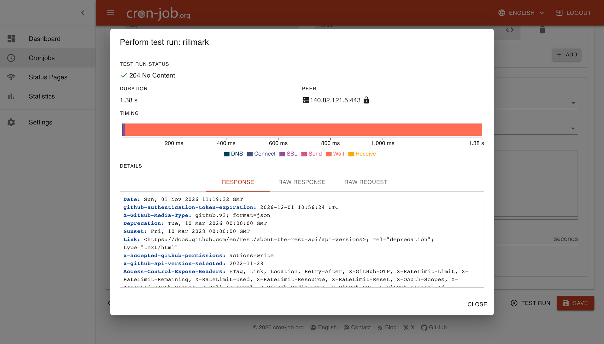
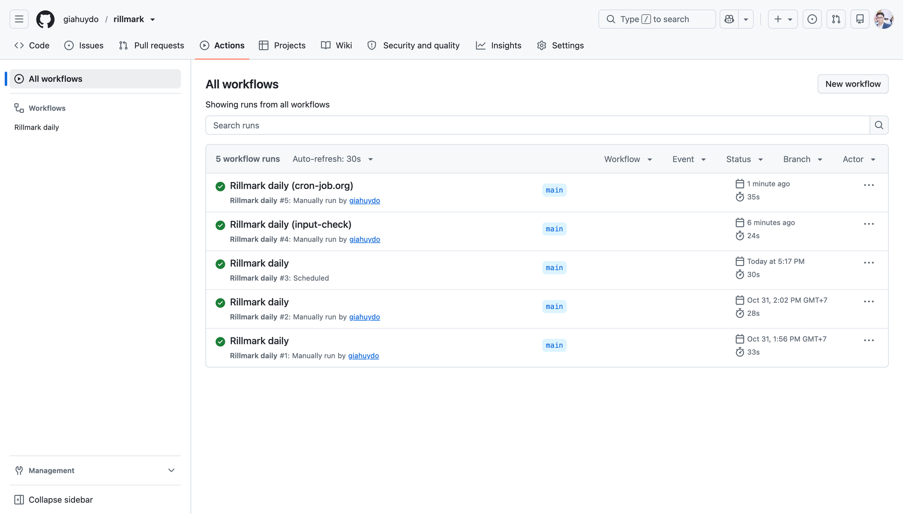
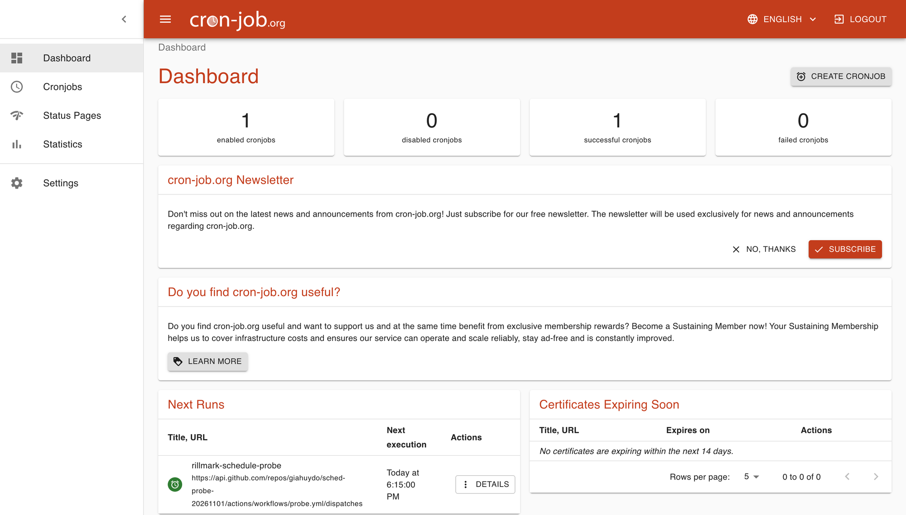
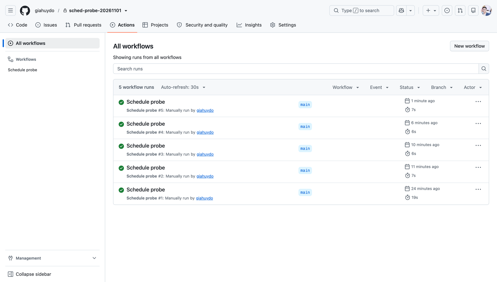

# 04 — Operations

Back to [docs index](README.md). Related: [ADR-0004](adr/0004-scheduler.md), [03-sync-lifecycle](03-sync-lifecycle.md#6-exit-codes), [02-data-contracts](02-data-contracts.md#5-last_runjson-public-artifact).

## 1. Configuration

Secrets come from the environment; non-secret selection comes from versioned `config/selection.json` (R14). The repo ships `.env.sample` with placeholders only. Local Python runs load `.env` using `python-dotenv` before config validation (already-exported environment variables take precedence); Docker uses `--env-file .env` for configured runs. `--dry-run` fetches Zendesk but makes **no OpenAI calls**; it is not offline.

| Var | Required | Default | Notes |
|---|---|---|---|
| `API_KEY` | yes* | — | OpenAI project key. Literal name from the assignment's `docker run -e API_KEY=...` |
| `OPENAI_API_KEY` | yes* | — | Accepted if `API_KEY` is unset (*one of the two) |
| `VECTOR_STORE_ID` | no | unset → project-local marker resolution | If set, retrieve it and require vector store `metadata.managed_by = "rillmark-optibot-v1"`, else fail closed. If unset, list all pages of stores in the key's project and filter by the marker: 0 → create named `rillmark-optibot` with marker and no `expires_after`; 1 → reuse; >1 → fail closed. Display name is never used for matching. |
| `ZENDESK_BASE_URL` | no | `https://support.optisigns.com` | |
| `SECTION_IDS` | no | `config/selection.json` → `section_ids` | Optional comma-list override; default `[26324076807315, 26324141467539, 26324224269459]` (VERIFIED 2026-10-30: 37 articles). |
| `YOUTUBE_ARTICLE_ID` | no | `config/selection.json` → `youtube_article_id` | Optional override; default `360051014713`. `min_articles` = 30 in versioned selection; validate the complete set before `--limit N`. |
| `MAX_CHUNK_SIZE_TOKENS` / `CHUNK_OVERLAP_TOKENS` | no | from [ADR-0002](adr/0002-chunking-and-citation.md) | |
| `ARTIFACT_*` | required for scheduled public publishing; optional locally | unset → local file only | Public GitHub Gist publisher approved by the project author; gist-scope token only. A local/evaluator run without publishing credentials skips publication; scheduled runs require it and fail if it fails. See §4. |

For the author's Playground, scope the key to the same project so the store appears in its picker (G1). A grader's key is in another project and resolves or creates a separate marked store there. Store marker and file-attribute marker are distinct: file attributes retain `managed_by = "rillmark-optibot-v1"`. `--init-store` is removed; default sync resolves or creates the store.

## 2. Docker contract

- Base `python:3.12-slim`, non-root user, pinned dependencies, **exec-form** `ENTRYPOINT ["python"]` and `CMD ["main.py"]`. Docker's documented exec-form argv semantics are deterministic (exercised by the local container dry-run): `docker run <image>` → `python main.py`; `docker run <image> main.py` replaces CMD with `main.py` → `python main.py`. Do **not** append `python main.py` to this image: it would become `python python main.py` if passed as CMD arguments.
- Default sync resolves the store in the key's project: `VECTOR_STORE_ID` set → retrieve it, require vector store `metadata.managed_by = "rillmark-optibot-v1"`, else fail closed. Unset → list stores in the key's project (all pages), filter by the store marker: 0 → create (named `rillmark-optibot`, with marker, no `expires_after`); 1 → reuse; >1 → fail closed. Display name is never used for matching. Listing/retrieval errors fail closed; never infer an empty list from an error. `--init-store` is removed. A grader's key resolves its own project's store, not the author's ID.
- **Primary acceptance command:** `docker run -e API_KEY=... <image> main.py`. The image includes the non-secret `config/selection.json`; default sync validates ≥30 selected articles and YouTube inclusion before upload, then resolves or creates its project-local marked store. This command is a planned contract, **UNVERIFIED until G0 + P4** (fresh authorized project/key, real image and exit 0). Insufficient credits/permissions or unsafe ambiguity must fail honestly, not fake success. `docker run --env-file .env <image> main.py` is the configured alternative; `.env` may provide `API_KEY` and optional overrides/`VECTOR_STORE_ID` without committing secrets. Do not embed any key or project-specific ID in the image. `--limit N` is a deterministic pilot upload cap after full ≥30 validation; it includes the YouTube article and longest file, labels counts `pilot`, and never detaches/deletes.
- A successful configured sync runs once and exits 0; configuration, sync, or required-publication failure exits non-zero (see §4). No volume needed for ephemeral `out/*.md`; local `last_run.json` inside the container is not durable by itself.

## 3. Scheduling (cron-job.org → GitHub Actions)

The job runs in `.github/workflows/rillmark-daily.yml` on a GitHub-hosted Ubuntu runner: it builds the existing Dockerfile and runs the non-root image once. No registry is needed. **cron-job.org triggers it every day**; GitHub's own `schedule` is a backup. Rationale in [ADR-0004](adr/0004-scheduler.md).

**Setup**

1. Publish the workflow on the default branch.
2. Repository secrets: `OPENAI_API_KEY` (mapped to container `API_KEY`) and `ARTIFACT_GITHUB_TOKEN` (gist scope). Repository variable `ARTIFACT_GIST_ID`; optional `VECTOR_STORE_ID` must identify a correctly marked store.
3. Manual check: Actions → Rillmark daily → Run workflow. `dry-run` (default) fetches and converts only, with no OpenAI or Gist credentials in the container. `sync` needs the three API/Gist settings and `REQUIRE_PUBLISH=true`; a missing setting fails by name without logging values.
4. Primary trigger: a cron-job.org job, daily at **03:23 UTC**:
   - `POST https://api.github.com/repos/giahuydo/rillmark/actions/workflows/rillmark-daily.yml/dispatches`
   - Headers: `Accept: application/vnd.github+json`, `Authorization: Bearer <fine-grained token>`, `X-GitHub-Api-Version: 2022-11-28`, `Content-Type: application/json`
   - Body: `{"ref":"main","inputs":{"mode":"sync","trigger":"cron-job.org"}}`
   - Expected response: `204 No Content`. The token has **Actions: read and write** on this repository only and lives only in cron-job.org.
5. Backup trigger: repository variable `RILLMARK_SCHEDULE_ENABLED=true` enables the GitHub cron `47 3 * * *` (off the hour). If both fire, the second run finds no changes and skips every file.

Runs are named by trigger: `Rillmark daily (cron-job.org)`, `(github-schedule)` or `(manual)`.

The job passes `GIT_SHA` into the container for report correlation. The application keeps its timestamp-based `run_id`, timestamps, status, added/updated/skipped counts and publication status. Compare the Actions log summary and uploaded JSON with the public Gist JSON; match `run_id`, `finished_at` and `git_sha`.

The container writes into its own filesystem. `docker start --attach` propagates its exit code; an `always()` step copies `/app/last_run.json` with `docker cp`, then removes the container. The collector deletes any checkout report first so stale evidence can't be uploaded. Cancellation or runner loss can prevent collection. Workflow artifacts can require login; the fixed public Gist is the anonymous evidence link.

Read-only contents permission, serialized non-cancelling runs and a 20-minute timeout stay enabled. The fine-grained token expires after 90 days and must be renewed in cron-job.org.

### Scheduler evidence (1 Nov 2026)

| Check | Result |
|---|---|
| GitHub `schedule`, 03:00 UTC slot (cron then `0 3 * * *`) | Delivered **7 h 18 min late**: [run 41296858382](https://github.com/giahuydo/rillmark/actions/runs/41296858382), `event=schedule`, created 10:17:52 UTC, `sync`, `skipped=37`, `publish=ok`. A 14-minute `*/5` window on 31 Oct produced no run |
| Fresh private probe repo, GitHub `*/5 * * * *` | **No `schedule` run in 45 minutes** (10:27–11:12 UTC) |
| Same probe, cron-job.org every 5 minutes | Dispatch returned `204`; runs at 11:00, 11:01, 11:05, 11:10 UTC, all successful |
| This repo, cron-job.org test run | `204 No Content`; [run 41301381940](https://github.com/giahuydo/rillmark/actions/runs/41301381940) `Rillmark daily (cron-job.org)`: `run_id=2026-11-01T11:19:53Z`, `sync`, `skipped=37`, `publish=ok`, `git_sha e8f70f7`, matching the public Gist |

Probe repository, five-minute external dispatch:

Conclusion: the job works on both triggers. GitHub's own scheduler is **not dependable for timing**: it delivered the daily event seven hours late and delivered nothing to the probe in 45 minutes, matching GitHub's documented delays and drops. cron-job.org fired on time every time, so it is the primary trigger and GitHub's cron stays as a backup.

### 3. Scheduling (Render Cron Job)

Legacy section retained for existing links. Render setup is superseded by the GitHub Actions instructions above; no Render service is required.

## 4. Logs and public run artifact

The assignment asks to “provide a link to job logs or last run artefact”. GitHub Actions provides run logs; the public Gist provides an anonymous **artifact** link.

- Stdout: one structured line per **part-file** action, plus an explicit-unit summary such as `summary mode=sync selected_articles=37 added_part_files=2 updated_part_files=1 skipped_part_files=34 managed_files_completed=37 all_store_files_completed=37 chunks_estimated=37 chunks_actual=null chunks_basis=serialized-file-budget deletion_candidates=0 failed=0 publish=ok`. Counts of articles, attached part-files and estimated chunks are different units. Use `pilot` for a `--limit N` run; pilot never detaches/deletes. Source-absent IDs/count are `deletion_candidates` only; replacement cleanup on an updated article's own old version remains allowed. `files` is actual `file_counts.completed`; `chunks.estimated` has `chunks.basis`, and `chunks.actual = null`. Retrieval checks validate citations, not chunk cardinality (G3 **UNKNOWN**).
- Produce local `last_run.json` using the [schema](02-data-contracts.md#5-last_runjson-public-artifact) for each attempted run, including partial/failure outcomes where possible. Before publication, construct an explicit public-field allowlist (schema fields only); strip credentials, headers, raw Zendesk bodies, HTML, emails, user text, stack traces, and sensitive URLs. `errors[]` may contain only a safe numeric article ID where available, an allowlisted stage, and a generic redacted message (never raw exception text). The store ID is not a secret per the schema, but do not add new identifiers or payload fields. Review the serialized payload for secrets/PII before sending.
- After sync, attempt publication even on `partial_failure`/`failed` if safe metadata exists. A successful publish does **not** turn a partial/failed sync into `success`: retain accurate `status`, `counts.failed`, `errors[]`, and non-zero exit as appropriate. If publish fails, log a redacted `publish_failed` event with `run_id` and reason category to stderr/Actions logs, annotate the **local** artifact with a safe `errors[]` entry (`stage=publish`), set public-schema `status=failed` locally (preserving sync counts and the separately logged sync outcome), and exit non-zero. If the local write itself fails, stderr/Actions logs remain the failure signal. The old public URL may still serve a stale previous run and **cannot report its own publisher failure**: never claim it shows the latest run; use Actions logs/local artifact for diagnosis. Publishing an unsafe payload must fail closed, not leak it. Distinguish sync outcome and publication outcome in the final log line.
- **G5 method APPROVED (owner): public GitHub Gist.** Use only a gist-scope token for the fixed [public Gist](https://gist.github.com/giahuydo/4968a3eec9704d752fbacb239964ee21). Its existing `last_run.json` URL remains unchanged. The optional `history.json` publisher enhancement is local-only until reviewed and deployed; do not claim it exists in the public Gist yet. Alternatives below are contingency only, requiring fresh approval:

| Option | How | Pros | Cons |
|---|---|---|---|
| **A. GitHub Gist (APPROVED method)** | Update fixed **public** Gist files via gist-scope-only token | Stable artifact URL; optional bounded history after deployment | Scheduled freshness must be checked against the cloud run |
| B. Commit to a `runs` branch (approval required) | GitHub contents API with least-privilege repo credential | Lives in the repo | Commit noise; repo-write permission |
| C. Render log screenshots | Manual fallback evidence | No publisher credential | Not a live public URL; does not by itself close R13/G5 |

### Optional run history (not required by the assignment)

[History schema](02-data-contracts.md#5a-historyjson-optional-public-run-history): `schema_version=1`, `retention=30`, `runs` newest first with unique timestamp `run_id`. Each record contains `run_id`, `started_at`, `finished_at`, `mode`, sync `status`, `publish=ok`, `git_sha`, and the seven §5 `counts` (article/part-file semantics unchanged). No raw errors or arbitrary fields. On an eligible non-dry run, GET the fixed Gist and validate its existing files, seed history from a valid prior `last_run.json` when history is absent, merge by run ID, sort and trim to 30, then PATCH **both** files in one request. Other Gist files are untouched. An older run may join history but must not replace a newer `last_run.json`; if the existing latest artifact is missing while history is newer, fail closed.

Malformed/truncated history or invalid prior public metadata must not be overwritten. GET/PATCH errors fail publication with redacted `publish_failed` logging; local `last_run.json` records `publish=failed`, `status=failed` and a generic publish error, and the process exits non-zero. A successful publish of a failed/partial sync retains its sync status/counts in both files. A failed publish does not add a history record, and the public Gist may remain stale. Recovery: inspect the Actions run log and local artifact, repair the malformed Gist file only after review, then rerun; no earlier runs are fabricated. The deployed workflow's concurrency group serializes its own runs; unrelated writers to this Gist are not covered by a compare-and-swap guarantee.

After implementing approved A (or separately approving B), validate the **anonymous raw public URL** in a browser/private session or unauthenticated GET: HTTP 200, valid JSON, expected `run_id` and `finished_at` for the same scheduled execution, fresh status/counts, and no secrets/PII. Test a partial sync and a publisher failure before treating it as reliable. If Gist implementation fails, seek separate approval for B or a demonstrably public job-log URL; screenshot C is supplementary and does not close the public-link gate without an approved live R13 link. Do not represent the undeployed `history.json` as an existing public artifact.

## 5. Runbook (short)

| Symptom | Check | Fix |
|---|---|---|
| Exit 1, `failed`, auth error | Key project, credits (G0) | Rotate the key in the same project; add credits |
| Picker does not show the store | Key/store project mismatch | Recreate the key in the Playground's project |
| `partial_failure` repeated | `errors[]` in the fresh artifact; compare `run_id` to logs | Re-run after diagnosing. Recovery converges ([03 §5](03-sync-lifecycle.md#5-recovery-and-dedup)). |
| Store unexpectedly empty | Wrong project/ID, missing marker, or `expires_after` set | Never set expiry; verify project and marker. Explicit ID mismatch fails closed; absent ID lists all pages and applies 0/create, 1/reuse, >1/fail. |
| Public artifact stale/missing | Compare public `run_id` with Actions log run_id and `publish_failed` logs | Treat run as failed, retain local failure record where possible; repair approved publisher and revalidate anonymous URL. |

## 6. Root README deliverable outline

To be written in P5, not now. Hard limit: ≤ 1 page.

1. One-line purpose plus the **verified** public daily artifact link (or explicitly mark G5 open; never use an unverified placeholder as evidence).
2. Setup: Python 3.12, `cp .env.sample .env`, `pip install -r requirements.txt`.
3. Run locally: `cp .env.sample .env` (local `python-dotenv` loads it; exported values win), `python main.py --dry-run` (fetches Zendesk, **no OpenAI calls**), then `python main.py` for sync after G0. Non-secret `config/selection.json` supplies selection; `SECTION_IDS`/`YOUTUBE_ARTICLE_ID` and `VECTOR_STORE_ID` are optional overrides. Docker: `docker build` then primary `docker run -e API_KEY=... <image> main.py` (planned; verify after G0 + P4); configured alternative `docker run --env-file .env <image> main.py`. No `--init-store`.
4. Chunking strategy (3 bullets, from [ADR-0002](adr/0002-chunking-and-citation.md)), plus how the file and chunk counts are logged and what the chunk number is based on.
5. Delta logic (2 bullets, from [ADR-0003](adr/0003-sync-state.md)).
6. Assistant: model, a pointer to the verbatim prompt, `vector_store_id`. Note that saved prompts shut down on 2026-11-30, so the screenshot is the evidence.
7. Screenshot (YouTube question).
8. What I cut (honest list).

## 7. Acceptance gates

- [ ] Docker exec-form argv and **primary** `docker run -e API_KEY=... <image> main.py` verified with an authorized fresh project/key after G0: full selection, 0/create then 1/reuse, completed uploads, required-publication behavior and exit 0. Until G0 + P4 this is **UNVERIFIED**; configured `--env-file` path is additional evidence, not a substitute.
- [ ] GitHub Actions Docker execution verified on the default branch; one scheduled run succeeded (not only a manual trigger) with matching timestamp/run ID in an approved public artifact.
- [ ] Approved public-Gist artifact URL opens without auth, validates as safe JSON, and matches the same scheduled run's `run_id`; partial sync and publisher failure are truthfully reported (G5 method approved; URL/live proof **UNKNOWN**). A stale public URL never claims the latest attempt.
- [ ] Before the **first commit**, scan root README and any published docs for internal tracking IDs, tooling/assistant names and private notes; remove them from public-facing files. Check fixtures/raw support content license/ToS before publishing (**UNKNOWN**). The owner must approve the first commit's contents before any commit/push. `git grep` for `sk-` and other key patterns is empty; `.env` is git-ignored.
