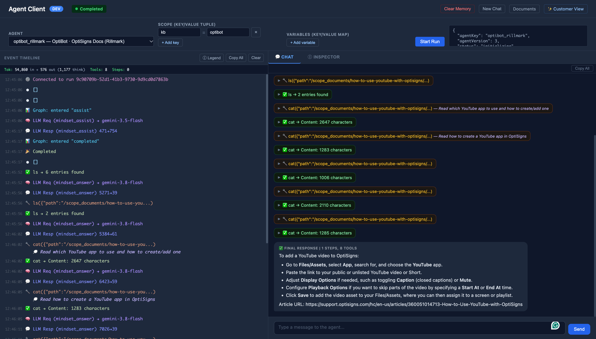

# Engineering Decisions & Independent Extension

*Rillmark · OptiBot Mini-Clone · 31 October 2026*

The primary implementation follows the take-home requirements. These decisions prioritize **compatibility, reproducibility, cost awareness, and verifiable results**. The independent agent implementation described below is **beyond the assignment scope**.

## 1. Technology decisions

| Choice | Why it was selected | Alternative / trade-off |
| --- | --- | --- |
| **OpenAI Vector Stores + Playground** | Programmatic upload, hosted `file_search`, and an accessible Playground workflow align with the required API upload and UI demonstration. | **Gemini File Search** supports API-based RAG, but attaching an API-created store in the required **AI Studio UI** was not verified. This is a UI-workflow risk, not a claim that Gemini lacks RAG. |
| **GitHub Actions + Docker** | Runs the existing container daily, integrates with the repository, and exposes workflow logs and artifacts. Standard runners are free for public repositories under GitHub's policy. | **Render Cron Jobs** are suitable and were considered, but have a **$1/month minimum** per service. A separate paid host added no benefit for this batch job. |
| **Public GitHub Gist** | A stable, anonymously accessible `last_run.json` URL provides the evidence requested by the assignment. | Workflow logs and run-specific artifacts remain available in GitHub Actions. |

Other hosting options—including Railway, Fly.io, AWS, and GCP—were considered but not required. Some signup/payment flows created onboarding friction; this is **not** a claim that those platforms are unavailable or universally paid. Railway offers a Free plan alongside its paid Hobby plan; Fly.io commonly requires a payment method.

**Billing clarification:** OpenAI documents a **$5 minimum initial prepaid API credit purchase**. This is *account credit*, **not $5 per answer**. API usage is billed separately from consumer chat subscriptions. The assignment permits either OpenAI or Gemini; OpenAI was selected for its lower-risk required UI path, not because OpenAI is mandatory.

## 2. Verified deployment evidence

- [Docker cloud dry-run](https://github.com/giahuydo/rillmark/actions/runs/41178613868): **PASS**, 37 articles processed without API uploads.
- [Docker live sync](https://github.com/giahuydo/rillmark/actions/runs/41178971431): **PASS**, 37 skipped, 0 added, 0 updated; commit `d3f57ff`.
- [Public run report](https://gist.github.com/giahuydo/4968a3eec9704d752fbacb239964ee21): **VERIFIED**, `publish=ok`, matching the live run.

The daily trigger is **cron-job.org dispatching the workflow at 03:23 UTC**, with GitHub's own cron as a backup, because GitHub's schedule arrived 7 hours late in our test ([ADR-0004](adr/0004-scheduler.md), [evidence](04-operations.md#scheduler-evidence-1-nov-2026)). The runs above were dispatched by hand before that switch. The [OpenAI Playground screenshot](screenshots/openai/optibot-youtube-playground.png) captures the first-turn YouTube answer and a file citation, but the answer does not include the full `Article URL:` line required by the acceptance checklist.

## 3. Beyond scope: independently developed agent workflow

I also implemented and exercised **OptiBot on StrangeLoop**, an independently developed agent-workflow system. This is an **optional technical demonstration**, **not a replacement** for the prescribed OpenAI / Gemini submission.

**Platform documentation:** [StrangeLoop — Architecture & Developer Docs](https://agent-platform-docs-sable.vercel.app/). These describe the underlying platform, not the OptiBot run itself. The OptiBot-specific UI and run evidence is linked below; source code and private execution details remain subject to access permissions.

| Capability | Demonstrated result |
| --- | --- |
| **Self-managed orchestration** | Control over agent flows, execution limits, tool permissions, and citation rules. |
| **Controlled knowledge access** | The same **37 articles** were indexed as approximately **186 sections** in a scoped document service. |
| **Grounded responses** | A read-only agent used `search`, `cat`, `head`, `grep`, and `ls` to answer the YouTube question and cite the source article. |
| **Independent engineering** | Workflow and retrieval architecture are under my control; source walkthroughs and execution traces can be shared **on request**, subject to ownership and confidentiality checks. |

### Demo evidence — StrangeLoop Studio (local)

These screenshots show the independently configured OptiBot in a local StrangeLoop Studio and one grounded agent execution. They are **additional engineering evidence**, not a public deployment or a replacement for the required OpenAI Playground proof. The rubric gives a separate **+5 for tests**, while extra engineering work beyond the requested scope has no specified point value.

| Evidence | What it shows |
| --- | --- |
| [Agent overview](screenshots/strangeloop/agent-overview.png) | Active OptiBot version, agent description, tool list and system prompt. |
| [Agent configuration](screenshots/strangeloop/agent-configuration.png) | Model selection and bounded execution settings. |
| [Prompt and grounding rules](screenshots/strangeloop/agent-prompt.png) | Verbatim OptiBot prompt plus read-only document-search/citation instructions. |
| [Flow graph](screenshots/strangeloop/agent-flow.png) | Documentation search-and-answer state with a completed terminal. |
| [Studio run timeline](screenshots/strangeloop/studio-run-timeline.png) | One completed run, tool-use trace and execution statistics. |
| [Agent Client answer](screenshots/strangeloop/agent-client-youtube-answer.png) | YouTube setup answer grounded in `ls`/`cat` results, including an explicit OptiSigns `Article URL:`. |

**Sample output (Agent Client):**

**Evidence boundary:** Screenshots establish visible local UI state and this specific run; they do not independently demonstrate source ownership, continuous reliability or external deployment. No fixed extra-credit points are claimed. The document store, access rules, and orchestration are self-managed, but the demo uses a **hosted Gemini model** for inference. It is **not fully offline**, and context supplied to the model may be processed by a third party.

## Official references

- **AI and billing:** [OpenAI File Search](https://developers.openai.com/api/docs/guides/tools-file-search) · [Gemini File Search](https://ai.google.dev/gemini-api/docs/file-search) · [AI Studio Agents](https://ai.google.dev/gemini-api/docs/aistudio-agents) · [OpenAI prepaid billing](https://help.openai.com/en/articles/8264644-setting-up-and-managing-prepaid-api-billing).
- **Hosting:** [GitHub Actions billing](https://docs.github.com/en/actions/concepts/billing-and-usage) · [GitHub scheduled workflows](https://docs.github.com/en/actions/reference/events-that-trigger-workflows#schedule) · [Render Cron Jobs](https://render.com/docs/cronjobs) · [Railway pricing](https://docs.railway.com/pricing) · [Fly.io pricing](https://fly.io/docs/about/pricing/).

See [AI provider ADR](adr/0001-ai-provider.md), [scheduler ADR](adr/0004-scheduler.md), and [operations](04-operations.md) for implementation detail.
