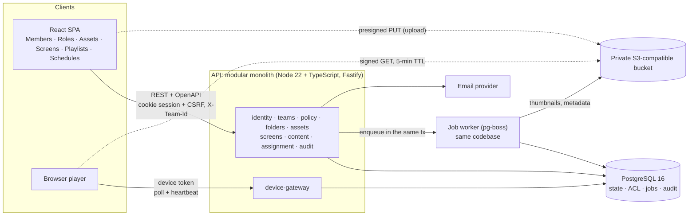

# 4. Architecture

← [3. Scope](03-scope.md) · [Overview](README.md) · [5. Data model and authorization](05-data-model-and-authorization.md) →

*PROPOSED. One deployable API plus a worker from the same codebase; files never pass through the API.*

| Choice | Why | Rejected alternative |
|---|---|---|
| Modular monolith | Assign, Move and quota need transactions spanning Teams, folders and Screens: plain `BEGIN … COMMIT` | Microservices: sagas and ops overhead for 2 engineers |
| PostgreSQL + row locks | Quota sums, unique memberships, TOCTOU protection, `pg_trgm` search | — |
| ACLs in Postgres | Snapshot inheritance makes evaluation leaf-only (one folder row) | OpenFGA/SpiceDB: a second store adds lag exactly where revoke-then-assign needs read-your-writes |
| pg-boss queue | Small workloads; enqueue in the same transaction = free outbox | Redis/SQS |
| Presigned upload/download | API never streams gigabytes; reads only after `authorize()` | Public CDN URLs: can't be revoked |
| Server-side sessions | Removing a member takes effect on the next request | JWTs that outlive a removal |
| REST | Per-route authorization is easier to review and test exhaustively | GraphQL (SCIO's public API); can be layered on later |

---

← [3. Scope](03-scope.md) · [Overview](README.md) · [5. Data model and authorization](05-data-model-and-authorization.md) →
