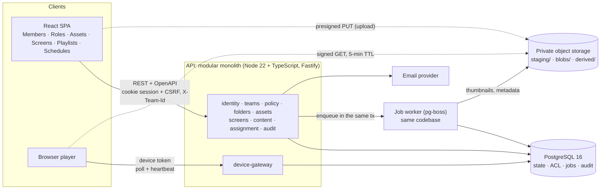
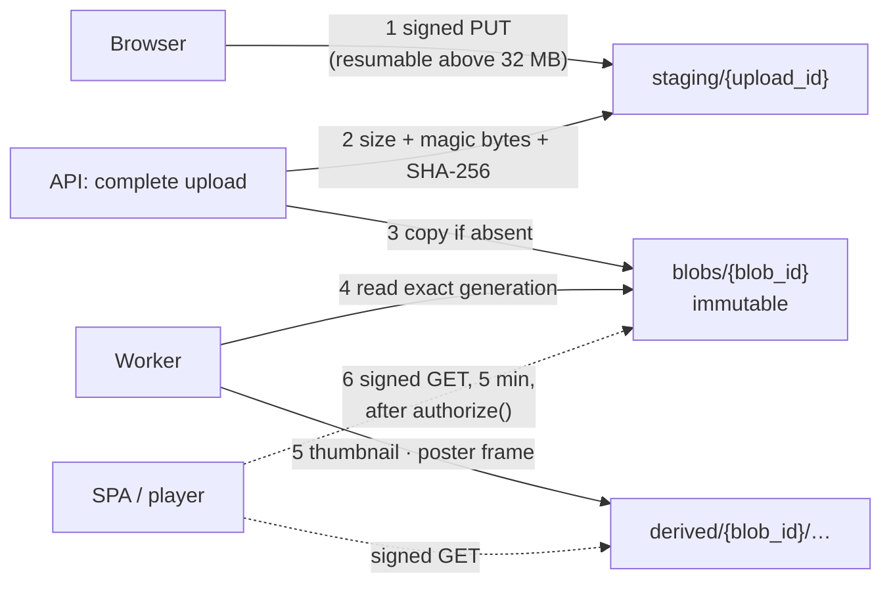

# 4. Architecture

← [3. Scope](03-scope.md) · [Overview](README.md) · [5. Data model and authorization](05-data-model-and-authorization.md) →

*PROPOSED. One deployable API plus a worker from the same codebase; files never pass through the API.*

| Choice | Why | Rejected alternative |
|---|---|---|
| Modular monolith | Assign, Move and quota need transactions spanning Teams, folders and Screens: plain `BEGIN … COMMIT` | Microservices: sagas and ops overhead for 2 engineers |
| PostgreSQL + row locks | Quota sums, unique memberships, TOCTOU protection, `pg_trgm` search | — |
| ACLs in Postgres | Snapshot inheritance makes evaluation leaf-only (one folder row) | OpenFGA/SpiceDB: a second store adds lag exactly where revoke-then-assign needs read-your-writes |
| pg-boss queue | Small workloads; enqueue in the same transaction = free outbox | Redis/SQS |
| Presigned upload/download | API never streams gigabytes; reads only after `authorize()` | Public CDN URLs: can't be revoked |
| Object storage behind a small port | GCS in production, MinIO in dev and CI; the port has only signed PUT/GET, copy-if-absent, read, delete ([§4.1](#41-file-storage)) | Hard-wiring one cloud SDK into the assets module |
| Server-side sessions | Removing a member takes effect on the next request | JWTs that outlive a removal |
| REST | Per-route authorization is easier to review and test exhaustively | GraphQL (SCIO's public API); can be layered on later |

## 4.1 File storage

The Brief's Asset actions (preview, download, duplicate, replace, delete) and its plan-dependent size and storage limits are decided here, below the folder layer. *PROPOSED throughout; SCIO's internals are not known.*

**Two rules carry the design:**

1. **Bytes are immutable and owned by the account.** An upload becomes a `blob`; nothing ever overwrites it. Object keys hold opaque IDs only, never a filename, Team or folder. Moving an Asset, renaming it, sharing its folder or moving a Screen to another Team changes rows in Postgres and never touches storage.
2. **Postgres records the exact bytes.** Each `blob` stores the key, the provider's object generation (version) and the SHA-256. Every read, preview and promotion names that generation, never "whatever is at this key now".

*Steps 1–6 of one upload. Everything under `staging/` that is older than 24 h is removed by a bucket lifecycle rule, so abandoned uploads cost nothing.*

**Key layout:** `a/{account_id}/staging/{upload_id}`, `a/{account_id}/blobs/{blob_id}`, `a/{account_id}/derived/{blob_id}/thumb-320.webp | poster.jpg`. Grouping by account keeps one prefix per tenant for export, deletion on account closure and cost reports.

**Promotion is idempotent:** the copy into `blobs/` succeeds only if the target does not exist yet (`ifGenerationMatch: 0` on GCS, `If-None-Match: *` on S3). A retried complete that finds the object already there re-hashes it and accepts it only on the same SHA-256. A blob is `ready` only after that check, so the UI and the player never get a URL for bytes still in staging.

**How each Asset action maps to storage:**

| Action | Postgres | Storage |
|---|---|---|
| Upload | `upload` row, quota reserved under a lock; then `blob` + `asset` + `asset_version 1` | Staging → `blobs/`; worker writes `derived/` |
| Preview | `authorize(view)` | Signed GET of a derived file: thumbnail for images and the first page of a PDF, poster frame for video; the PDF itself opens in the browser viewer. Files are never sent to a third-party viewer |
| Download | `authorize(view)` | Signed GET of the original, 5 min, `Content-Disposition: attachment; filename="<asset name>"` |
| Duplicate | New `asset` + `asset_version` pointing at the **same** `blob` | None |
| Replace | New `blob`; in one transaction `asset.current_blob` and `version` change, the Asset ID stays | New object; the old blob stays for 30 days (version history, rollback) |
| Move, Rename, share, Move To Team | Rows only | None |
| Delete | Moves to Trash (refused with `409 ASSET_IN_USE` while referenced, [§6](06-lifecycles.md)); purged after 30 days | A daily GC job deletes a blob and its `derived/` files once no Asset, version or Trash entry references it |

**Quota:** the account pool documented for SCIO (10 GB per paid screen, 1 GB per file, [§2](02-scio-today.md)) is counted as the sum of **distinct live blobs** in the account, including the 30-day Replace and Trash retention. A Duplicate is free, a Replace briefly counts twice. Optional per-Team caps are checked on the same reservation. The initiate call reserves the declared size and complete settles the real size, so parallel uploads can't overshoot.

**Player caching:** manifest URLs include the `blob_id`, so the player caches by blob and re-downloads only after a Replace. A signed URL already handed out stays valid until its 5-minute TTL ends, and a file the player has cached stays on the device. Revoking access stops new URLs; it does not erase copies already delivered ([§10](10-risks-and-open-questions.md#10-risks)).

**Deliberately cut:** virus scanning (the staging → promote step is where a scanner would plug in, between steps 2 and 3), Office conversion (a non-goal in [§3](03-scope.md); a PDF copy would be one more file under `derived/`), video transcoding (originals play as uploaded, within the codec allowlist) and CDN delivery. None of them changes the data model.

**Provider choice:** GCS, because it gives V4 signed URLs, resumable uploads, generation preconditions and lifecycle rules out of the box, and keeps the stack on one cloud. S3 offers the same four (multipart instead of resumable), so the port stays thin enough to switch.

---

← [3. Scope](03-scope.md) · [Overview](README.md) · [5. Data model and authorization](05-data-model-and-authorization.md) →
