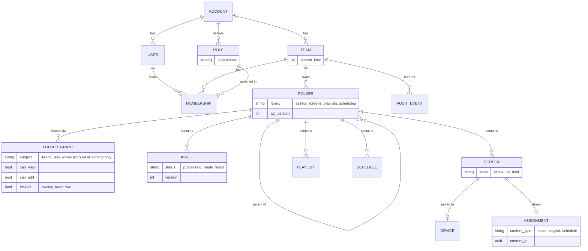
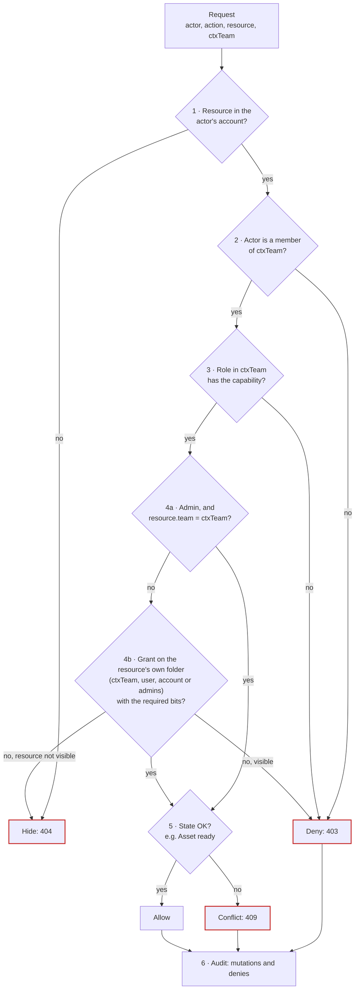

# 5. Data model and authorization

← [4. Architecture](04-architecture.md) · [Overview](README.md) · [6. Key lifecycles](06-lifecycles.md) →

**Core entities (abbreviated):** `account`, `team(screen_limit)`, `user`, `session`, `role(capabilities[])`, `membership(team, user, role)`, `invitation`, `folder(team, family, parent, acl_version)`, `folder_grant(subject team|user|account|admins, can_view, can_edit, locked)`, `asset(folder, status, current_blob, version)`, `asset_version(asset, blob, version)`, `blob(account, object_key, generation, sha256, size, mime, status)`, `upload(account, declared_size, staging_key, expires_at)`, `screen(team, folder, state, device)`, `device`, `pairing_code`, `assignment(screen, content_type, content_id, flags)`, `playlist`, `schedule`, `audit_event`. Content belongs to a **Team**, never a user, so deleting a user orphans nothing. Bytes belong to the **account**: a `blob` is immutable and may back several Assets (Duplicate), so moving content between folders or Teams never touches storage ([§4.1](04-architecture.md#41-file-storage)).



*PROPOSED. Every folder family (Assets, Screens, Playlists, Schedules) uses the same `folder` and `folder_grant` tables; `assignment` points to an Asset, a Playlist or a Schedule.*

**One decision function:**

```text
authorize(actor, action, resource, ctxTeam) → Allow | Deny(reason) | Hide
 1. Tenant      resource in actor's account                       else Hide (404)
 2. Context     actor is a member of ctxTeam (or account role)    else Deny
 3. Capability  action ∈ role capabilities in ctxTeam             else Deny
 4. Folder ACL  admin bypass only if resource.team == ctxTeam
                else grant on the resource's own folder ⊇ required bits
                (grants to ctxTeam, to the user, to the whole account, or to
                 admins of the owning Team; grants to other Teams don't count)
 5. State       e.g. Asset ready                                  else 409
 6. Audit       mutations and denies recorded
```



*PROPOSED. Red outlines are the refusal exits. Step 4a is the only admin bypass, and it never crosses Teams.*

Lists, search, pickers, thumbnails and downloads use the **same predicate as SQL joins**, so a list never shows what a detail call would refuse. Hidden resources return 404; visible-but-forbidden returns 403.

**Custom roles** use SCIO's grid exactly (15 toggles; Tags needs Edit) and are account-wide, as in SCIO. Administration, viewing and download stay fixed to default roles; viewing is governed by folders. The role is checked before the folder (step 3 before step 4), so Read Only stays read-only even on an Edit folder, as observed in SCIO.

**Required folder bits:**

| Action | View | Edit |
|---|:-:|:-:|
| List, preview, search, download, use as assignment source | ✓ | |
| Upload into a folder | | ✓ |
| Rename, replace, delete, settings, move out | ✓ | ✓ |
| **Change a Screen's content (rule S1)**, on the Screen's folder | ✓ | ✓ |

Changing a Screen's content also needs the Screens Edit capability. The content itself needs only View on its own folder and no Files capability, which matches SCIO.

**Decisions taken in this plan** (fail-closed defaults; each is one switch if the product team or new evidence says otherwise):

| # | Decision | Default | Cost to flip |
|---|---|---|---|
| D2a | Screen content change needs Screen-folder **Edit** (S1) | **Matches SCIO's server**: a View-only Push is refused with PERMISSION_DENIED | ~0.5 day |
| D2b | Admin ACL bypass only inside the context Team | Matches SCIO's UI: a Team Admin sees only its own Team, cannot share across Teams or account-wide, and has no Move To Team. The Owner acts account-wide (observed); we treat Super Admin the same way (not verified) | ~1 day |
| D2c | Only the context Team's grants count | Decisions explainable from one Team | — |
| D3a | Assigning a Playlist/Schedule delegates display of items the assigner can't see; adding an item needs View on it | Mixed Playlists stay usable. **SCIO matches on assignment** (a User assigned a playlist with a hidden item) but shows the hidden item's details; we show a placeholder | Strict variant ~1 day |
| D3b | **Revoking a share affects authoring, not playback**: assignment stays, is flagged, new assigns denied | Stores don't go blank. **Matches SCIO:** revoking a share kept the assignment and hid the item from the User | Strict variant ~1 day |
| D4 | Assignable in MVP: Asset + minimal Playlist + minimal Schedule | All three content types the BRIEF lists | Cut M9 −4 days |
| D5 | 2 engineers + 0.5 QA; 63 + 13 days | [§9](09-estimate.md) | — |

---

← [4. Architecture](04-architecture.md) · [Overview](README.md) · [6. Key lifecycles](06-lifecycles.md) →
