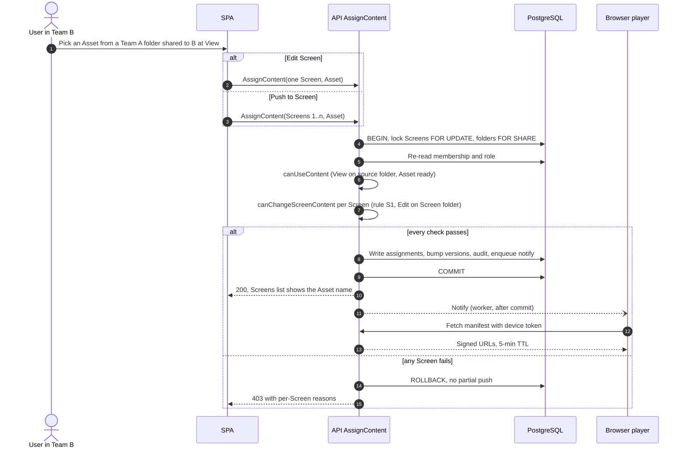

# 6. Key lifecycles

← [5. Data model and authorization](05-data-model-and-authorization.md) · [Overview](README.md) · [7. Security and tests](07-security-and-tests.md) →

**Upload:** initiate (capability + folder Edit, size limit, MIME allowlist, storage reservation under a lock) → browser PUTs to `staging/` with a signed URL → complete (re-authorize, size + magic-byte check, SHA-256, promote to an immutable blob, Asset `processing`) → worker makes thumbnails, poster frames and metadata → `ready` or `failed` ([§4.1](04-architecture.md#41-file-storage)). A "Create And Share" warning appears when the folder is shared. Replace keeps the **same Asset ID** and points it at a new blob, so Screens and Playlists pick up the new file; Duplicate creates a new Asset on the same blob. Delete moves to Trash only if unreferenced; otherwise `409 ASSET_IN_USE`, listing only references the actor can see. Trash is purged after 30 days; a daily GC job then deletes blobs nothing references.

**Pairing:** the player requests a 6-character code (10 min, single use, hashed, rate-limited) and keeps a random pairing secret. A User with `screen.pair` + Edit on the target Screen folder submits the code; one transaction checks Team and account capacity and creates the Screen. Only the originating player, holding the secret, can claim the device token.

**Move To Team:** both Teams authorized; Teams locked in ID order; if the destination is full, `409` offers **move one licence with the Screen** (`moveLicence=true`, needs `account.manage_teams`). The Screen lands in the destination root and its assignment is **cleared**, as SCIO does; the response says so, so the UI can offer to reassign. **OnHold** frees capacity and suspends (does not delete) the assignment; reactivation re-checks capacity and restores it, as SCIO does.

**Assignment (both UI paths):**

```text
AssignContent(actor, ctxTeam, screens[], contentRef)
BEGIN
  lock screens FOR UPDATE; lock source + screen folders FOR SHARE
  re-read actor's membership and role
  canUseContent: View on the source folder (cross-Team grant allowed), content ready
  canChangeScreenContent(each screen): one named predicate (S1 default)
  any failure → ROLLBACK with per-Screen reasons (no partial push)
  write assignments, bump versions, audit, enqueue device notify (same tx)
COMMIT
```

The UI hides or disables controls to match, but **disabled buttons aren't the boundary**: the API rejects a View-only change on both paths. The player resolves content with its own device credential and gets 5-minute signed URLs.



*The user journey (a Team B User assigning an Asset from a folder shared at View, by Edit Screen and by Push) is VERIFIED UI in SCIO. Everything behind the API is PROPOSED.*

---

← [5. Data model and authorization](05-data-model-and-authorization.md) · [Overview](README.md) · [7. Security and tests](07-security-and-tests.md) →
