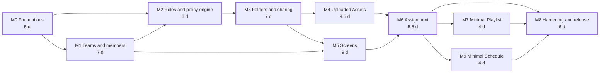
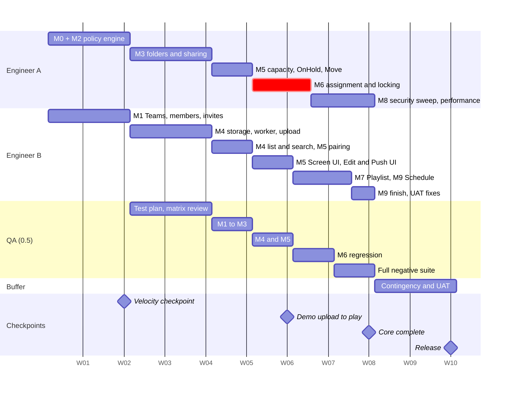

# 8. Milestones

← [7. Security and tests](07-security-and-tests.md) · [Overview](README.md) · [9. Estimate, and where AI coding assistants change it](09-estimate.md) →

| ID | Milestone | Main contents | Eng-days | Depends on |
|---|---|---|---:|---|
| M0 | Foundations | Repo, CI, compose (Postgres, MinIO, mail), migrations, sessions, error model, audit table, multi-Team fixtures, staging | 5 | — |
| M1 | Teams & members | Teams + quota invariant, Add/Invite flows, remove vs delete, session revocation, Team switcher, Members UI | 7 | M0 |
| M2 | Roles & policy engine | Capability catalog, seeded + custom roles with escalation guard, `authorize()`, generated matrix tests | 6 | M0, M1 |
| M3 | Folders & sharing | Typed trees, grants, snapshot inheritance, Change Permission UI, Shared with me, ACL-joined list helper, locking | 7 | M2 |
| M4 | Uploaded Assets | Presigned upload + reservation, staging → immutable blob promotion, worker (thumbnails, poster frames, metadata), search/preview/download, duplicate/replace, Trash + reference guard, blob GC, Create And Share warning | 9.5 | M3 |
| M5 | Screens | Pairing + device token, browser player, Screen folders/settings, capacity, OnHold, Move To Team | 9 | M3, M1 |
| M6 | Assignment | `AssignContent`, Edit Screen + Push (multi-select), locking tests, revoke flags, device manifest | 5.5 | M4, M5 |
| M7 | Minimal Playlist | Ordered items + durations, partial-visibility placeholder, assignable, player loop | 4 | M6 |
| M9 | Minimal Schedule | Single-window events, "Non-accessible item", assignable, player picks the active event | 4 | M6 |
| M8 | Hardening & release | Negative suite completion, IDOR sweep, rate limits, logs/metrics, ACL performance at 10k Assets / 500 folders, runbook, UAT fixes | 6 | all |
| | **Core** | | **63** | |
| | **Contingency (20%)** | Reserved for rules not fully verified in SCIO (Super Admin scope, delete of an assigned Asset, playlist item visibility) plus ordinary estimation error | **13** | |

*Thick outline: Engineer A's critical chain M0 → M2 → M3 → M6 → M8 (about 30 eng-days).*

**Calendar (2 engineers, 4 focus days/week each):**

| Week | Engineer A (backend-leaning) | Engineer B (frontend-leaning) | QA (0.5) | Milestone |
|---|---|---|---|---|
| 1–2 | M0; M2 policy engine | M1 Teams, members, invites | — | **Velocity checkpoint ([§9](09-estimate.md))** |
| 3–4 | M3 folders & sharing | M4 storage, worker, upload pipeline | Test plan, matrix review | |
| 5 | M5 capacity, OnHold, Move | M4 list/search/replace/Trash; M5 pairing + player | M1–M3 | |
| 6 | M6 assignment + locking | M5 Screen UI; Edit Screen / Push UI | M4/M5 | **Demo: upload → pair → assign → play** |
| 7 | M6 finish; M8 security sweep | M7 Playlist; M9 Schedule | M6 regression | |
| 8 | M8 performance, logging | M9 finish; UAT fixes, docs | Full negative suite | **Core complete** |
| 8.5–10 | Contingency | Contingency | UAT | **Release** |

*W01 is plan week 1; the dates are only there to draw the chart. Each bar is calendar time at 4 focus days a week per engineer, not eng-days.*

**Critical path:** M0 → M2 → M3 → M6 → M8 on Engineer A (~30 eng-days ≈ 7.5 weeks). A third engineer would shorten the calendar by at most about a week, because the policy chain can't be split without two people editing the same code.

**Cut order if late:** apply-to-subfolders → custom-role UI polish → multi-select Push → M9 → M7 (the last two disclosed as a BRIEF gap). **Never cut:** server-side `authorize()`, the negative matrix, transactional assign/move/quota.

---

← [7. Security and tests](07-security-and-tests.md) · [Overview](README.md) · [9. Estimate, and where AI coding assistants change it](09-estimate.md) →
