# Phases, Estimates & Gates

Back to [docs index](README.md). Budget: **about 8 focused hours** for Part 1 (assignment). Estimates are one-developer effort hours, not calendar time; owner approval and waiting for the first daily schedule are separate. Source-absence deletion and default splitting are cut to protect the must-haves.

## Summary

| Phase | Goal | Est. | Needs G0 (credits)? | Exit gate |
|---|---|---|---|---|
| P0 | Unblock: credits + project key | 0.25 h (owner) | — (this *is* G0) | G0 closed |
| P1 | Scrape → Markdown (Zendesk only; no OpenAI calls) | 2.0 h | No | ≥ 30 clean `.md`, converter tests green |
| P2 | Pilot upload + validation, then full set | 1.25 h | Yes | G1/G2 checked; G3 limitation disclosed |
| P3 | Delta sync (no source-absence deletion) | 0.75 h | Yes (live part) | Second run all skipped; candidates logged |
| P4 | Docker + Render Cron + approved Gist artifact | 2.0 h | Yes | One scheduled run, public link |
| P5 | Screenshot, root README, public hygiene | 1.0 h | Yes | Deliverables checklist |
| | **Total** | **≈ 7.25 h** | | 0.75 h buffer; estimates must be rechecked as work proceeds |

P1 can run **in parallel with** P0, because Zendesk discovery and conversion need no paid provider API calls.

```mermaid
gantt
  dateFormat X
  axisFormat %s h
  section Owner
  P0 credits + key        :p0, 0, 1
  section Build
  P1 scrape→markdown      :p1, 0, 10
  P2 upload + gates       :p2, after p1, 6
  P3 delta sync           :p3, after p2, 4
  P4 docker + render      :p4, after p3, 6
  P5 screenshot + README  :p5, after p4, 4
```

(units = 15 min)

## P0 — Unblock (owner)

- Add minimal API credits (for example $5) before the paid validation runs gated by G0.
- Create a **project-scoped** API key in the OpenAI project used by the Playground. Sync resolves the marked store in that key's project: `VECTOR_STORE_ID` set → retrieve and require vector store `metadata.managed_by = "rillmark-optibot-v1"` or fail closed; unset → list all pages, filter by marker: 0 → create named `rillmark-optibot` with marker and no `expires_after`; 1 → reuse; >1 → fail closed. Display name is never a match key. The grader's other-project key resolves or creates its own store. `--init-store` is removed.
- Approve the cost envelope for P2 validation (planning estimate: < $0.10, ASSUMPTION).
- **Gate G0**: the project author confirms a positive credit balance and that the key exists. Automation never handles billing.

## P1 — Scrape → Markdown

- Start from the VERIFIED public API discovery snapshot (13 categories, 74 sections, 416 `en-us` articles; coherent primary selection of 37 includes YouTube `360051014713`) and the 416-body HTML survey and ten fixtures. Version non-secret `config/selection.json` with `section_ids` = `[26324076807315, 26324141467539, 26324224269459]`, `youtube_article_id` = `360051014713`, `min_articles` = 30; optional `SECTION_IDS`/`YOUTUBE_ARTICLE_ID` env overrides. G6 is mostly resolved; implement the evidenced conversion rules and verify output.
- Implement `zendesk.py`, `convert.py`, slug, `--dry-run` (fetches Zendesk, **no OpenAI calls**). Write focused converter tests; offline means fixture tests only.
- Measure the **serialized** Markdown file token length (including header) with tiktoken `o200k_base` and record max/p95. The primary set's body-text max ≈1.9k tokens is an **ASSUMPTION** proxy (words×1.35), not a measured file count. Enforce the per-file token budget before upload: fail clearly on oversize, no silent truncation. Build the H2-split fallback only if P1 measurement requires it ([ADR-0002](adr/0002-chunking-and-citation.md)).
- **Gate**: ≥ 30 files, the YouTube article included, every [02 §6](02-data-contracts.md#6-acceptance-gates) check passes; token max/p95 recorded.

## P2 — Upload + validation (3 articles → all)

`--limit 3` caps uploads **after** complete ≥30 selection validation. Pick a deterministic subset that always includes the YouTube article and the longest serialized file; if the two coincide, fill remaining slots deterministically. `--limit N` is a pilot, not proof of full-set coverage: label counts `pilot`, never detach/delete (including replacement cleanup), and retain the full source selection guard. Upload completed part-files with file-attribute `managed_by = "rillmark-optibot-v1"`; full sync follows pilot evidence.

1. Resolve/create the project-local store by vector store `metadata.managed_by = "rillmark-optibot-v1"` per P0, not by name; optional `VECTOR_STORE_ID` must retrieve with the marker. No `--init-store`.
2. Pilot-upload capped files; poll for `completed`.
3. **G1**: verify the author's store appears in and attaches to the Playground picker.
4. **G2**: verbatim prompt, first-turn YouTube question → verify correct URL line and citation chip.
5. **G3**: timebox authoritative provider chunk-count-method investigation. Search beginning/middle/end or sample retrieval may validate content/citations but **cannot establish cardinality**. Record actual completed `files` (`file_counts.completed`), `chunks.estimated`, `chunks.basis`, `chunks.actual = null`; G3 stays **UNKNOWN** unless an authoritative exact method exists. Disclose the R6 limitation in root README.
6. If safe, full sync the validated set. Hash input: `sha256("v{schema_version}\nchunk={max}/{overlap}\n" + normalized_markdown)` so chunk-setting changes re-upload.

If G1 fails, inspect key/project then contact the grader. If G2 fails, inspect converted content and retrieval; only build H2-split fallback if P1 budget measurement requires it. No sample search can close G3.

**Gate**: Record G1/G2 results and the G3 **UNKNOWN** limitation; proceed only after approval from the project author. A pilot is never full-run acceptance evidence.

## P3 — Delta sync

- `state.py` classification and `vector_store.py` safe replace/recovery ([03](03-sync-lifecycle.md)). Source-absence deletion is deferred: log absent IDs/count as `deletion_candidates`, do not detach/delete them. Keep attach-new → completed → detach-old replacement cleanup for an updated article's own old version (full sync only). Write focused classify/fake-client tests.
- **Gate**: live run twice gives `skipped=N` on the second run; a forced `schema_version` bump gives `updated=N`.

## P4 — Docker + Render + artifact

- Dockerfile, `.env.sample`, exec-form `ENTRYPOINT ["python"]` + `CMD ["main.py"]`. Primary acceptance command: `docker run -e API_KEY=... <image> main.py` resolves/creates the marked store in the key's project and uses versioned selection; **UNVERIFIED until G0 + P4**. Verify fresh-project run, rerun/reuse, argv, completed uploads and exit 0; configured `docker run --env-file .env <image> main.py` is additional evidence. Local Python uses `python-dotenv` to load `.env` with exported vars taking precedence. Never embed secrets or project-specific IDs.
- Render Cron service, daily schedule; **leave custom command unset** to use image defaults. Render semantics are UNKNOWN until P4: check current docs/UI and actual no-upload argv/exit; only use `main.py` if Render requires and demonstrably replaces CMD arguments, never `python main.py` under that behavior. Stop before paid/scheduled work if it overrides ENTRYPOINT or differs.
- Public GitHub Gist publisher method **APPROVED** by the project author; use gist-scope-only token. URL, cost, anonymous live proof stay **UNKNOWN** until implementation. Scheduled publishing is required; local/evaluator runs without publisher credentials skip it. Publish only allowlisted/redacted JSON. Exit 0 **only** if sync and required publish succeed; partial/failed sync → 1; successful sync with failed publish → 1 and `publish_failed`. A stale public URL must never claim it shows the latest attempt. Test both failure paths and compare public `run_id` to scheduled logs.
- **Gate**: one *scheduled* run succeeded, matching approved anonymous Gist `last_run.json` JSON URL (`run_id`, timestamp, safe status/counts); check partial and publish-failure outcomes. G5 URL/live proof and primary one-flag Docker run remain **UNVERIFIED** until separately observed.

## P5 — Deliverables

- E4 screenshot, root README ≤ 1 page ([outline](04-operations.md#6-root-readme-deliverable-outline)), cryptic repo name and secrets scan. **Before first commit**, remove internal tracking IDs, tooling/assistant names and private notes from public-facing root README and published docs. License/ToS clearance for fixtures/raw support content is **UNKNOWN**: check before publishing. Commit/push only after the project author approves first-commit contents; no public repo operation is authorized by this plan.
- **Gate**: [00 §8](00-requirements.md#8-acceptance-gates-for-this-doc) and [05 §5](05-testing.md#5-acceptance-gates) are all checked, or cut items are listed in the README.

## Cut order if over budget

1. **Cut automatic source-absence deletion now** (log `deletion_candidates`; no detach/delete for absence). Keep safe update replacement.
2. **Cut default splitting now**; build H2 fallback only if P1 serialized-file measurement requires it. Oversize files fail clearly until fixed, never truncate.
3. Implement only the **approved Gist publisher**, not multiple backends; alternatives require separate approval if it fails. Retain allowlist, redaction, required-publish exit gate.
4. Cut optional kill-test/recovery live check and Responses-API CLI helper if behind; keep focused tests, citation checks, and daily public evidence. Timebox G3 research; never call search evidence actual chunk counts.

## Open gates register

| ID | Gate | Status | Blocks | Resolution path |
|---|---|---|---|---|
| G0 | API credits and project key not yet in place | **BLOCKED: owner** | P2–P5 | Owner confirms positive balance and key |
| G1 | API store → Playground picker → attach E2E | **UNKNOWN** | P2 | Live check with 3 files |
| G2 | YouTube answer has the correct `Article URL:`, with a screenshot | **UNKNOWN** | P2, P5 | Live check; fallback split |
| G3 | Actual embedded chunk cardinality | **UNKNOWN** (not exposed by the API) | R6 disclosure | Log actual completed files, `chunks.estimated`/`chunks.basis`, `chunks.actual = null`; search validates citations, not count |
| G4 | Saved prompt shutdown 2026-11-30 | Risk accepted | Review period | Screenshot + README reproducibility info |
| G5 | Public GitHub Gist method approved; cost, URL and live proof pending | Method **APPROVED**; URL/cost/live proof **UNKNOWN** | P4, R13 | Gist-scope token; anonymous fresh/redacted JSON plus partial/publish-failure proof ([04 §4](04-operations.md#4-logs-and-public-run-artifact)) |
| G6 | Real Zendesk HTML shapes | **Mostly resolved** (416-body survey, ten fixtures) | P1 converter output | Implement evidenced rules; test future shapes separately |
| Docker primary CLI | Literal one-flag key-only command with versioned selection and project-local marker resolution | **UNVERIFIED until G0 + P4** | P4 | Run authorized fresh/repeat project acceptance, no name matching ([04 §2](04-operations.md#2-docker-contract)) |
| Render command | Unset custom command must preserve image ENTRYPOINT/CMD | **UNKNOWN** | P4 | Read Render docs/UI and verify no-upload argv/exit before scheduling ([04 §3](04-operations.md#3-scheduling-render-cron-job)) |

## Out of scope

- **Part 2, SCIO Slice Plan: Deferred.** It needs about 10 hours of its own and a Brief A/B choice by the project author. Both parts are submitted together, so plan its slot before the submission date.
