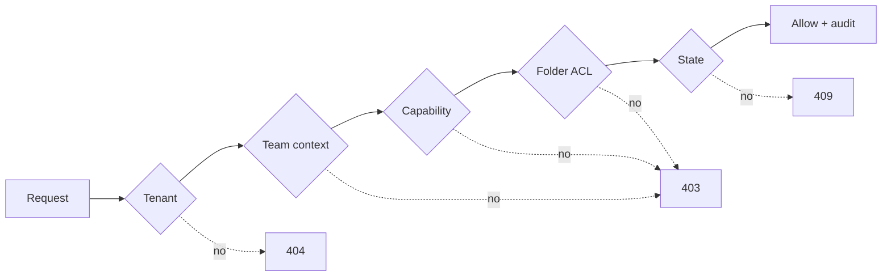

import { Badge, Card, CardGrid, LinkCard } from '@astrojs/starlight/components';

<CardGrid>
  <Card title="What" icon="puzzle">
    A multi-Team management portal and a thin browser player. One server-side
    `authorize()` decides every read and write; one `AssignContent` command
    serves both Edit Screen and Push to Screen.
  </Card>
  <Card title="Order" icon="list-format">
    Foundations → policy engine → folders → Assets ∥ Screens → assignment →
    minimal Playlist and Schedule → hardening. See
    [Milestones](/plan/milestones/).
  </Card>
  <Card title="How long" icon="seti:clock">
    Committed: 63 core eng-days + 13 contingency with 2 engineers and 0.5 QA,
    about 8 weeks core and 9.5–10 with contingency. See
    [Estimate](/plan/estimate/).
  </Card>
  <Card title="Why this shape" icon="approve-check">
    The risk is authorization semantics, not volume. Rules we could not fully
    verify in SCIO sit behind one named predicate each.
  </Card>
</CardGrid>

## The authorization decision

The full flow, including the admin bypass and the hidden-versus-forbidden
rule, is on [Data model & authorization](/plan/data-model-and-authorization/).

## Evidence labels

Every claim about SCIO carries one of these labels:
<Badge text="BRIEF" variant="note" /> <Badge text="DOCUMENTED" variant="tip" />
<Badge text="VERIFIED UI" variant="success" /> <Badge text="MANUAL CHECK" variant="success" />
<Badge text="INFERRED" variant="caution" /> <Badge text="UNKNOWN" variant="danger" />
<Badge text="PROPOSED" variant="default" />. PROPOSED is our design and is never
a claim about SCIO internals.

## Pick a path

<CardGrid>
  <LinkCard title="How SCIO works today" description="What we observed in the trial, and what is still unknown." href="/plan/scio-today/" />
  <LinkCard title="Architecture" description="Modular monolith and the alternatives we rejected." href="/plan/architecture/" />
  <LinkCard title="Lifecycles" description="Upload, pairing, Move To Team, assignment." href="/plan/lifecycles/" />
  <LinkCard title="Milestones & calendar" description="Dependency graph, Gantt, critical path, cut order." href="/plan/milestones/" />
  <LinkCard title="Risks & open questions" description="Fallbacks, and what does not block the start." href="/plan/risks-and-open-questions/" />
</CardGrid>
